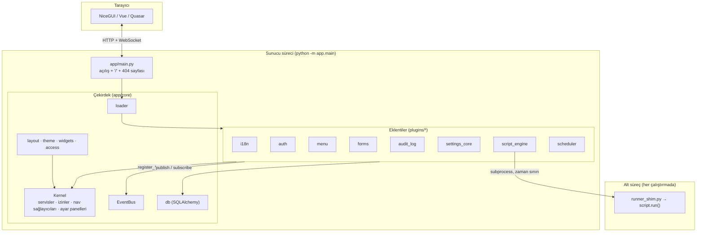
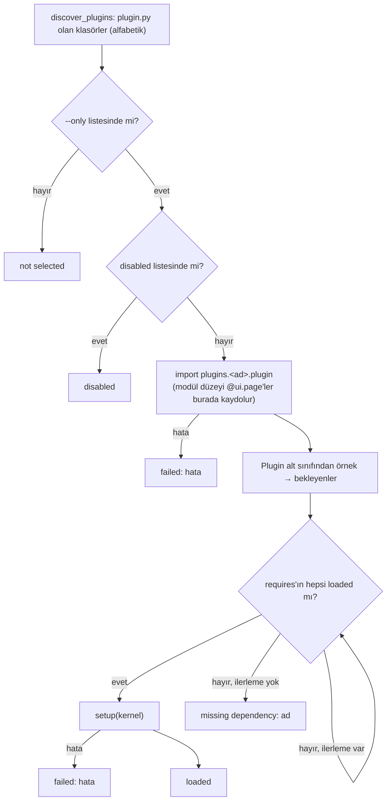
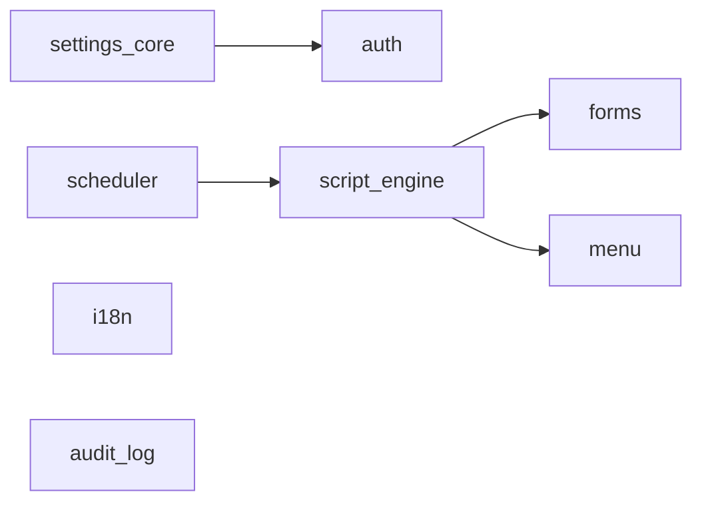
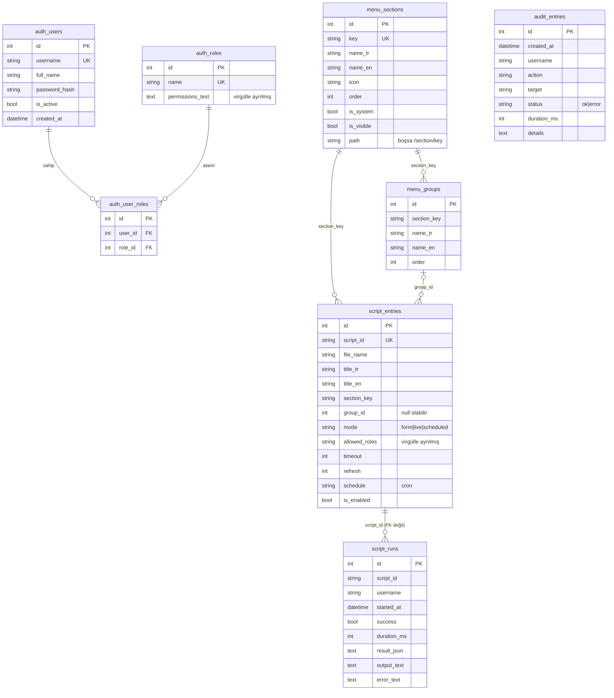
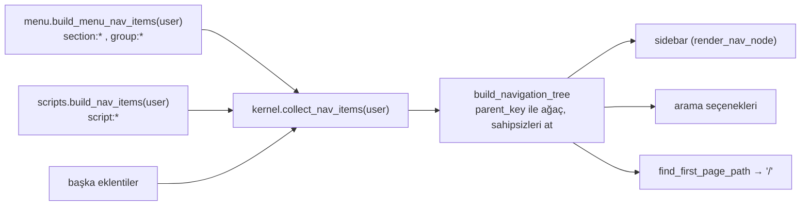
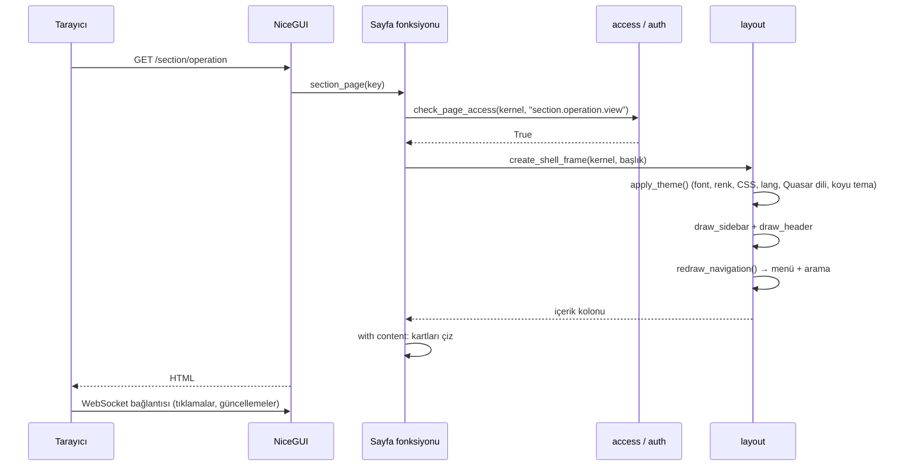
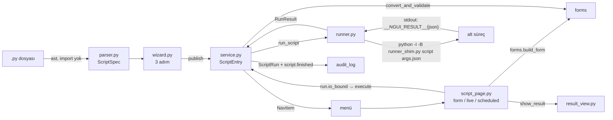

# N-GUI Tasarım Rehberi (Design Guide)

Bu rehber N-GUI'yi **geliştiren ve genişleten** kişiler içindir. Neyin neden böyle tasarlandığını,
parçaların birbirine nasıl bağlandığını, görsel tasarım sistemini ve kod yazım kurallarını anlatır.

Üç doküman birbirini tamamlar:

| Doküman | Okuyucu | İçerik |
|---|---|---|
| [ADMINISTRATION_GUIDE.md](ADMINISTRATION_GUIDE.md) | Yönetici, operatör | Kurulum, ayarlar, kullanıcı/rol/menü/script yönetimi, yedekleme, sorun giderme |
| **DESIGN_GUIDE.md** (bu dosya) | Geliştirici | Mimari, tasarım kararları, modül başvurusu, veri modeli, görsel tasarım sistemi, kurallar, genişletme tarifleri |
| [NASIL_CALISIR.md](NASIL_CALISIR.md) | Geliştirici | Adım adım kod turu: açılış sırası, bir isteğin ve bir script'in yolculuğu, docstring başvurusu |

İçindekiler:

1. [Amaç ve tasarım ilkeleri](#1-amaç-ve-tasarım-ilkeleri)
2. [Mimariye genel bakış](#2-mimariye-genel-bakış)
3. [Dizin yapısı](#3-dizin-yapısı)
4. [Çekirdek modül başvurusu](#4-çekirdek-modül-başvurusu)
5. [Eklenti modeli](#5-eklenti-modeli)
6. [Haberleşme: servisler ve olaylar](#6-haberleşme-servisler-ve-olaylar)
7. [Veri modeli](#7-veri-modeli)
8. [Kimlik, oturum ve yetki](#8-kimlik-oturum-ve-yetki)
9. [Menü modeli](#9-menü-modeli)
10. [Sayfa yaşam döngüsü ve NiceGUI bağlamı](#10-sayfa-yaşam-döngüsü-ve-nicegui-bağlamı)
11. [Çok dillilik (i18n)](#11-çok-dillilik-i18n)
12. [Script motoru tasarımı](#12-script-motoru-tasarımı)
13. [Form altyapısı](#13-form-altyapısı)
14. [Görsel tasarım sistemi](#14-görsel-tasarım-sistemi)
15. [Kod yazım kuralları](#15-kod-yazım-kuralları)
16. [Genişletme tarifleri](#16-genişletme-tarifleri)
17. [Test stratejisi](#17-test-stratejisi)
18. [Tasarım kararları ve ödünleşimler](#18-tasarım-kararları-ve-ödünleşimler)
19. [Bilinen sınırlar ve gelişim alanları](#19-bilinen-sınırlar-ve-gelişim-alanları)

---

## 1. Amaç ve tasarım ilkeleri

N-GUI, kurum içi bir ekibin (5-50 kişi) Python script'lerini tarayıcıdan, yetki kontrollü ve
kayıt altında çalıştırmasını sağlayan bir **web kabuğudur**. Hedef, arayüzle **bir kez**
uğraşmak, sonrasında işi kod yazmadan yürütmektir: *script'i yükle → form kendiliğinden oluşsun
→ menüdeki yerini seç → bitti.*

Bütün tasarımı yönlendiren ilkeler:

1. **Lego gibi çalışma.** Her yetenek `plugins/` altında ayrı bir klasördür. Eklenti takılıp
   sökülebilir; hatalı bir eklenti uygulamayı çökertmez, yalnızca kendisi "failed" olur.
2. **Küçük ve kararlı çekirdek.** `app/core/` hiçbir eklentiyi tanımaz. Yalnızca kayıt
   defterleri, olay yolu ve ortak arayüz parçaları sunar.
3. **Eklentiler birbirini import etmez.** Birbirleriyle **servisler** (`kernel.get_service`) ve
   **olaylar** (`kernel.events`) üzerinden konuşurlar. Servis yoksa `None` gelir ve kod buna göre
   davranır ("zarif bozulma").
4. **Menü veridir.** Bölüm ve gruplar veritabanında durur; yeni bölüm açmak kod değişikliği gerektirmez.
5. **Script import edilmez.** Script'in meta verisi `ast` ile okunur, script ayrı bir süreçte
   çalışır. Bozuk ya da kötü niyetli bir dosya sunucu sürecini etkileyemez.
6. **Basit olan kazanır.** Kod orta seviye Python bilen birinin okuyabileceği gibi yazılır:
   lambda, closure, kendi decorator'ımız, metaclass yoktur; Türkçe ve bol açıklama vardır
   (bkz. [bölüm 15](#15-kod-yazım-kuralları)).
7. **Tek görsel dil.** Bütün renkler ve sınıflar `app/core/theme.py` içinde, tekrar eden
   parçalar `app/core/widgets.py` içindedir. Her sayfa aynı görünür.

---

## 2. Mimariye genel bakış



Katmanlar:

| Katman | Sorumluluk | Bağımlılık yönü |
|---|---|---|
| NiceGUI | HTTP, WebSocket, Vue/Quasar bileşenleri, oturum depoları | — |
| Çekirdek | Kayıt defterleri, olay yolu, eklenti yükleme, ortak kabuk ve tema | Yalnızca NiceGUI ve SQLAlchemy'ye |
| Eklentiler | Bütün iş mantığı ve sayfalar | Çekirdeğe; diğer eklentilere yalnızca servis/olay üzerinden |
| Script alt süreci | Kullanıcının kodu | Hiçbir şeye (yalnızca stdin dosyası ve stdout protokolü) |

---

## 3. Dizin yapısı

```
n-gui/
├── app/
│   ├── main.py                 # giriş noktası, "/" ve 404 sayfası
│   └── core/                   # ÇEKİRDEK — eklenti import etmez
│       ├── kernel.py           # Kernel + get_kernel()/set_kernel()
│       ├── plugin.py           # Plugin sözleşmesi, NavItem, SettingsPanel
│       ├── loader.py           # eklenti keşfi, bağımlılık sırası, hata yalıtımı
│       ├── events.py           # EventBus
│       ├── config.py           # AppConfig + load_config + save_config_value
│       ├── db.py               # Base, init_database, get_session, create_all_tables
│       ├── access.py           # check_page_access
│       ├── layout.py           # create_shell_frame, refresh_navigation
│       ├── navigation.py       # NavNode, build_navigation_tree
│       ├── theme.py            # renkler, sınıf grupları, EXTRA_CSS, apply_theme
│       ├── widgets.py          # page_card, stat_card, status_badge, empty_state
│       ├── text.py             # t()
│       ├── field_spec.py       # FieldSpec (forms ↔ script_engine ortak tipi)
│       └── locales/            # kabuk metinleri (tr.json, en.json)
├── plugins/
│   ├── <eklenti>/
│   │   ├── plugin.py           # Plugin alt sınıfı (zorunlu)
│   │   ├── README.md           # ne yapar, servis, izin, olay, nasıl kapatılır
│   │   ├── locales/{tr,en}.json
│   │   ├── models.py           # (varsa) tablolar
│   │   ├── service.py          # (varsa) servis sınıfı
│   │   └── *_page.py / *_panel.py
│   └── ornek_eklenti_sablonu/  # kopyalanacak şablon (kapalı)
├── scripts/                    # kullanıcı script'leri ([scripts] folder)
├── tests/                      # pytest; bellek içi SQLite
├── data/                       # (çalışınca oluşur) app.db, uploads/
├── docs/
└── config.toml
```

---

## 4. Çekirdek modül başvurusu

| Modül | Genel API | Notlar |
|---|---|---|
| `kernel.py` | `Kernel(config)`; `register_service(ad, nesne)`, `get_service(ad)`; `register_permission(anahtar, açıklama_anahtarı)`, `list_permissions()`; `add_nav_provider(fn)`, `collect_nav_items(user)`; `register_settings_panel(panel)`, `list_settings_panels()`; `add_user_menu_item(item)`, `list_user_menu_items()`; alanlar: `config`, `events`, `plugin_status`, `loaded_plugin_folders`. Modül düzeyi: `set_kernel`, `get_kernel`, `current_kernel` | Uygulamada **tek** kernel vardır. `collect_nav_items` hata veren sağlayıcıyı loglayıp atlar |
| `plugin.py` | `Plugin` (`plugin_id`, `name`, `version`, `requires`, `setup(kernel)`); `NavItem(key, label, icon, path, parent_key=None, order=100)`; `SettingsPanel(key, label_key, icon, permission, build_function)`; `UserMenuItem(label_key, icon, on_click)` | `NavItem.label` **çevrilmiş** metindir; `UserMenuItem` avatar menüsünde "Çıkış"ın üstünde görünür |
| `loader.py` | `discover_plugins(klasör)`, `find_plugin_class(modül)`, `load_plugins(kernel, klasör, paket, only)` | Bkz. [bölüm 5](#5-eklenti-modeli) |
| `events.py` | `EventBus.subscribe(ad, handler)`, `EventBus.publish(ad, data)` | Senkron; handler hatası loglanır, zincir sürer |
| `config.py` | `AppConfig` dataclass; `load_config(yol)`; `save_config_value(yol, bölüm, anahtar, değer)`; `find_insecure_settings(config)` | Yazma satır bazlıdır, **yorumları korur**. Bütün anahtarlar: [ADMINISTRATION_GUIDE bölüm 3](ADMINISTRATION_GUIDE.md#3-configtoml-başvurusu) |
| `db.py` | `Base`; `init_database(url)`; `get_session()`; `create_all_tables()`; `add_missing_columns(engine, metadata)` | `:memory:` için `StaticPool`; SQLite klasörü kendiliğinden açılır; `expire_on_commit=False`; `create_all_tables` eksik sütunları da ekler |
| `access.py` | `check_page_access(kernel, izin_ya_da_None) -> bool` | `False` dönerse sayfa **hemen `return` etmelidir** |
| `layout.py` | `create_shell_frame(kernel, başlık) -> ui.column`; `refresh_navigation()`; `get_current_user(kernel)` | Bkz. [bölüm 10](#10-sayfa-yaşam-döngüsü-ve-nicegui-bağlamı) |
| `navigation.py` | `NavNode`; `nav_sort_key`; `build_navigation_tree(items)`; `find_first_page_path(nodes)`; `flatten_navigation_tree(nodes)` | Sahipsiz ve döngüdeki öğeler atılır |
| `theme.py` | Renk sabitleri, sınıf grupları, `EXTRA_CSS`, `page_language()`, `html_lang_script()`, `quasar_language_html()`, `apply_theme()` | Bkz. [bölüm 14](#14-görsel-tasarım-sistemi) |
| `widgets.py` | `page_card()`, `stat_card(başlık, değer, ipucu="")`, `status_badge(metin, renk)`, `empty_state(metin)`, `shorten_stat_value(metin)` | Eklentiler de bunları kullanır |
| `text.py` | `t(anahtar, **değerler)` | Kernel ya da i18n yoksa anahtarı döndürür |
| `field_spec.py` | `FieldSpec(name, field_type, label_tr, label_en, required, default, options, min_value, max_value, help_text)` | `forms` ve `script_engine` bu tipi paylaşır; bu yüzden çekirdektedir |

---

## 5. Eklenti modeli

### Sözleşme

Bir eklenti, içinde `plugin.py` bulunan ve `plugin.py` içinde `Plugin` alt sınıfı tanımlayan bir klasördür:

```python
class StokPlugin(Plugin):
    plugin_id = "stok"          # klasör adıyla aynı
    name = "stok"
    version = "1.0"
    requires = ["menu"]         # önce yüklenmesi gereken eklentiler

    def setup(self, kernel) -> None:
        kernel.register_service("stok", StokService(kernel))
        kernel.register_permission("stok.view", "stok.permission.view")
        kernel.add_nav_provider(self.build_nav_items)
```

`setup` dışında yaşam döngüsü kancası yoktur. Açılış/kapanış işi gerekiyorsa NiceGUI'nin
`app.on_startup` / `app.on_shutdown` kancaları kullanılır (örnek: `scheduler`).

### Yükleme algoritması (`load_plugins`)



- Bağımlılık sırası ayrıca hesaplanmaz: "hazır olanları kur, ilerleme kalmayana dek tekrarla"
  döngüsü sırayı kendiliğinden oluşturur. Döngüsel bağımlılık "missing dependency" ile sonuçlanır.
- **Sayfalar import anında kaydolur.** Kapalı eklentinin modülü hiç import edilmediği için sayfası
  da yoktur (adres "Sayfa bulunamadı" gösterir).
- Bir eklentinin `setup`'ı yarıda hata verirse o ana kadar yaptığı kayıtlar kernel'de kalabilir.
  Bu yüzden `setup` içinde önce hata verebilecek işleri (import, nesne kurma), sonra kayıtları yapın.

### Eklenti bağımlılık grafiği



Grafikte olmayan ilişkiler **isteğe bağlıdır**: `menu`, `script_engine`, `layout` gibi kodlar
`auth` ve `i18n` servislerini varsa kullanır, yoksa yetki süzmesi yapmaz / çevirmez.

---

## 6. Haberleşme: servisler ve olaylar

### Ne zaman servis, ne zaman olay?

| Durum | Kullanın |
|---|---|
| Bir şey **sormak** ya da bir işi **yaptırmak**, sonucu beklemek | Servis (`kernel.get_service("menu").list_sections()`) |
| Bir şeyin **olduğunu duyurmak**, kimin dinlediğini bilmeden | Olay (`kernel.events.publish("script.finished", {...})`) |

### Servisler

| Ad | Sınıf | Sahip | Başlıca metotlar |
|---|---|---|---|
| `i18n` | `Translator` | `i18n` | `t`, `translate`, `get_language`, `set_language`, `pick`, `load_folder` |
| `auth` | `AuthService` | `auth` | `authenticate`, `is_locked_out`, `login_user`, `logout_current_user`, `current_user`, `has_permission`, `list_users`, `create_user`, `update_user`, `change_password`, `change_own_password`, `has_default_admin_password`, `list_roles`, `create_role`, `set_role_permissions`, `delete_role` |
| `menu` | `MenuService` | `menu` | `list_sections`, `create_section`, `update_section`, `delete_section`, `list_groups`, `create_group`, `delete_group`, `pick_label` |
| `forms` | `FormsService` | `forms` | `build_form(fields) -> FormHandle`, `convert_and_validate(fields, raw)`, `discard_uploaded_file(path)` |
| `audit` | `AuditService` | `audit_log` | `write(...)`, `search(status, text, limit=2000, date_from="", date_to="")`, `purge_older_than(days)` |
| `scripts` | `ScriptService` | `script_engine` | `scan_folder`, `save_uploaded_file`, `parse`, `publish`, `set_enabled`, `remove`, `get_entry`, `list_entries`, `can_user_run`, `find_roles_without_section_access`, `execute`, `run_live`, `list_runs`, `last_run`, `purge_runs_older_than` |
| `scheduler` | `ScriptScheduler` | `scheduler` | `sync_jobs(entries)`, `run_job(script_id)`, `validate_schedule(cron)` |

Her eklentinin `README.md` dosyası kendi servisinin imzalarını listeler.

### Olaylar

| Olay | Yayınlayan | Veri | Dinleyen |
|---|---|---|---|
| `plugins.loaded` | `main.py` | `{}` | `i18n` (çevirileri okur) |
| `database.ready` | `main.py` | `{}` | `auth`, `menu` (seed), `scheduler` (eşitleme) |
| `auth.login` | `auth/login_page.py` | `{"username"}` | `audit_log` |
| `auth.login_failed` | `auth/login_page.py` | `{"username", "reason"?}`; kilitliyken `reason: "locked"` | `audit_log` |
| `auth.logout` | `auth/service.py` | `{"username"}` | `audit_log` |
| `auth.password_changed` | `auth/password_dialog.py` | `{"username"}` (parola yok) | `audit_log` |
| `script.finished` | `script_engine/service.py` | `{"username", "script_id", "success", "duration_ms", "error_text"}` | `audit_log` |
| `scripts.changed` | `script_engine/service.py` | `{"script_id", "change", "username"}` | `audit_log`, `scheduler` |
| `settings.changed` | `settings_core/changes.py`, `menu/settings_panel.py` | `{"username", "setting", "details"}`; `setting`: `users`/`roles`/`database`/`menu` | `audit_log` |

Olay kuralları:

- **Senkrondur.** `publish` bütün handler'lar bitince döner. Uzun iş yapacak handler kendi
  thread'ini açmalıdır.
- **Handler'lar başka thread'den çağrılabilir.** Script'ler `run.io_bound` ile worker
  thread'de çalıştığı için `script.finished` worker thread'de yayınlanır. Handler'lar
  NiceGUI arayüzüne dokunmamalı, veritabanı için **kendi oturumunu** açmalıdır
  (`with get_session() as session:`).
- Veri sözlüğüne **asla parola ya da gizli bilgi** koymayın; `audit_log` her şeyi kaydeder.
- Yeni olay adı `<alan>.<fiil>` biçiminde olsun (`stok.updated`).

---

## 7. Veri modeli



Tasarım notları:

- **Her eklenti kendi tablolarının sahibidir** ve tablo adlarını kendi önekiyle başlatır
  (`auth_`, `menu_`, `script_`, `audit_`). Başka eklentinin tablosuna doğrudan yazılmaz; servis kullanılır.
- Eklentiler arası "ilişkiler" (ör. `script_entries.section_key`) **yabancı anahtar değildir**.
  Bölüm silinince script kaydı silinmez, "sahipsiz" (atanmamış) olur. Böylece eklentiler
  birbirinden bağımsız açılıp kapanabilir ve veri kaybolmaz.
- `script_runs` ve `audit_entries` geçmiştir; script kaldırılınca silinmez.
- Roller izinleri **virgülle ayrılmış tek metin** olarak tutar; ayrı izin tablosu bu ölçekte
  gereksiz karmaşıklık olurdu.
- Tarihler sunucunun yerel saatiyle (`datetime.now`) yazılır.
- **Yalnızca eklemeli göç vardır.** `create_all_tables()` eksik tabloları oluşturur, ardından
  `add_missing_columns` modelde olup tabloda olmayan sütunları `ALTER TABLE ... ADD COLUMN` ile
  ekler. Sütun NULL olabilir eklenir; modelde sabit bir varsayılan varsa (`default="acik"`,
  `default=3`) `DEFAULT` olarak yazılır ve eski satırlar onu alır. `datetime.now` gibi fonksiyon
  varsayılanları SQL'e yazılamaz; eski satırlarda NULL kalır. Sütun silme, yeniden adlandırma ve tip
  değiştirme yapılmaz; bunlar için elle göç adımı yazılmalıdır. Bu yüzden modele yeni sütun
  eklerken ya NULL'a dayanıklı olun ya da sabit bir varsayılan verin.
- **Saklama süresi:** `[audit] retention_days` doluysa `audit_entries` ve `script_runs` kayıtları
  açılışta (`database.ready`) ve günde bir (`app.timer`) bu süreden eskiyse silinir.
- Oturumlar kısa yaşar: her servis metodu `with get_session()` ile kendi oturumunu açar ve kapatır.
  `expire_on_commit=False` sayesinde dönen nesneler oturum kapandıktan sonra da okunabilir;
  yine de servisler dışarıya model nesnesi değil **düz sözlük** döndürür.

---

## 8. Kimlik, oturum ve yetki

### Oturum

- Giriş başarılıysa yalnızca `app.storage.user["user_id"]` yazılır. NiceGUI bu depoyu
  `storage_secret` ile imzalı bir çerezle tarayıcıya bağlar ve sunucuda `.nicegui/` altında tutar.
- `auth.current_user()` kullanıcıyı **her çağrıda veritabanından** okur. Kullanıcı silinmiş ya
  da pasifse `None` döner; böylece pasif yapılan kullanıcının oturumu bir sonraki sayfada düşer.
  Önbellek yoktur; bu ölçekte doğruluk performanstan önemlidir.
- Aynı depoda `language` ve `dark_mode` de durur (kullanıcı başına değil, **tarayıcı oturumu**
  başına).

### Parola ve giriş politikası

- Parolalar bcrypt ile özetlenir. Kural: en az `[auth] min_password_length` karakter, en fazla 72
  bayt (`check_password_rules`). Tek istisna ilk admin'in oluşturulmasıdır
  (`create_user(..., enforce_password_rules=False)`): geliştirmede varsayılan `admin` parolasıyla
  girilebilsin diye.
- **Giriş kilidi** `AuthService` içinde, bellekte tutulur: `failed_logins` sözlüğü kullanıcı adı
  başına ardışık hata sayısını ve kilit bitişini saklar. `max_login_attempts` hatada ad
  `lockout_minutes` kilitlenir; kilitliyken `authenticate` doğru parolayı da reddeder. Var olmayan
  adlar da sayılır (kilit davranışı hangi adların var olduğunu ele vermesin). Sözlük 1000 adı
  geçerse süresi dolmuş kayıtlar atılır. Saat `self.clock` ile verilir; testler sahte saat takar.
  Bellekte olduğu için yeniden başlatmada sıfırlanır ve birden çok süreç arasında paylaşılmaz.
- **Kendi parolasını değiştirme:** `change_own_password(user_id, mevcut, yeni)` mevcut parolayı
  doğrular. Arayüzü `auth/password_dialog.py`'dir; auth eklentisi onu çekirdeğin kullanıcı menüsü
  kayıt defterine (`kernel.add_user_menu_item`) ekler. Böylece çekirdek auth'u tanımadan menüde
  "Şifremi değiştir" görünür.
- **Canlı ortam koruması:** `main.enforce_security` açılışta (tablolar ve seed hazır olduktan sonra)
  `find_insecure_settings` (varsayılan ya da 32 karakterden kısa `storage_secret`) ve
  `auth.has_default_admin_password()` sonuçlarını toplar. Geliştirmede uyarı yazar;
  `[app] environment = "production"` iken `sys.exit(1)` ile çıkar.

### İzin kontrolü

Middleware ya da decorator yoktur. **Her sayfa ilk satırında** açıkça kontrol eder:

```python
@ui.page("/stok")
def stok_page() -> None:
    kernel = get_kernel()
    if not check_page_access(kernel, "stok.view"):
        return
    content = create_shell_frame(kernel, t("stok.title"))
    ...
```

`check_page_access` sözleşmesi:

| Durum | Davranış | Dönüş |
|---|---|---|
| `auth` servisi yok | Kontrol yapılmaz | `True` |
| Giriş yok / kullanıcı pasif | `/login`'e yönlendirir | `False` |
| İzin `None` | Giriş yeterli | `True` |
| İzin var (`*` her şeyi kapsar) | — | `True` |
| İzin yok | Kabuk + "erişim izniniz yok" kartı çizer | `False` |

Sayfa izni yanında, **işlem anında** da izin tekrar denetlenir (ör. `ScriptService.current_user_can_manage()`).
Neden: panel açıkken kullanıcının izni geri alınmış olabilir.

### İzin adlandırması

`<alan>.<nesne>.<eylem>` ya da `<alan>.<eylem>`: `settings.users.manage`, `log.view`,
`section.<key>.view`. İzin açıklaması bir **çeviri anahtarıdır**; Roller ekranı onu `t()` ile gösterir.

### Script yetkisi

Script çalıştırma izin anahtarıyla değil, kaydın `allowed_roles` listesiyle belirlenir
(`ScriptService.can_user_run`). Böylece her script için ayrı izin üretip rol ekranını şişirmek
gerekmez; yetki script'le birlikte sihirbazda seçilir. Menüde görünmek için ayrıca bölüm izni
gerekir (script'in nav öğesinin ebeveyni, kullanıcı bölümü göremiyorsa ağaçta yoktur).

---

## 9. Menü modeli

Menü, sağlayıcıların ürettiği **düz bir `NavItem` listesinden** her çizimde yeniden kurulur:



Anahtar kuralları:

| Öğe | `key` | `parent_key` | `path` |
|---|---|---|---|
| Bölüm | `section:<key>` | `None` | `/section/<key>` ya da sistem bölümünün adresi (`/log`, `/settings`) |
| Grup | `group:<id>` | `section:<key>` | boş (yalnızca başlık) |
| Script | `script:<id>` | `group:<id>` ya da `section:<key>` | `/script/<id>` |
| Başka eklentinin sayfası | eklentiye özgü | genellikle `section:<key>` | eklentinin adresi |

- **Yetki süzmesi sağlayıcıdadır.** Her sağlayıcı yalnızca kullanıcının görebileceği öğeleri döndürür.
  Ebeveyni süzülen öğe ağaçta "sahipsiz" kalır ve kendiliğinden düşer; bu, "bölümü göremeyen
  script'i de göremez" kuralını ek kod yazmadan sağlar.
- Sıralama `order`, eşitse `label` iledir.
- Çocuğu olan düğüm katlanabilir başlık (`ui.expansion`), olmayan düğüm bağlantı satırıdır.
  Aktif sayfayı içeren başlık açık başlar.
- Sistem bölümleri (`log`, `settings`) sahibi eklenti yüklü değilse gösterilmez
  (`SYSTEM_SECTION_OWNERS`).

### Menünün güncellenmesi

Menü, sayfa her açıldığında hesaplanır. Aynı sayfada menüyü değiştiren bir işlem
(script yayınlama/kaldırma, bölüm/grup düzenleme, rol değişikliği) yapıldığında panel
`refresh_navigation()` çağırır: `create_shell_frame` açık sayfanın menü kolonunu yeniden çizen
fonksiyonu `app.storage.client` içinde saklar, `refresh_navigation` onu çağırır. Diğer kullanıcıların
sekmeleri bir sonraki sayfa açılışında güncellenir (sunucudan tüm istemcilere yayın yapılmaz).

---

## 10. Sayfa yaşam döngüsü ve NiceGUI bağlamı



Bulunamayan adresler `ui.run(root=not_found_page)` ile kabuk içinde "Sayfa bulunamadı"
kartına düşer (NiceGUI eşleşmeyen her adreste `root` fonksiyonunu çağırır).

### NiceGUI'ye özgü dikkat edilecekler

- **Her sayfa açılışı yeni bir `Client`'tır.** Sayfa fonksiyonu her istekte baştan çalışır;
  modül düzeyinde arayüz durumu tutmayın.
- **Depolar:** `app.storage.user` (tarayıcı oturumu, kalıcı: giriş, dil, tema) ve
  `app.storage.client` (yalnızca açık sekme, bellekte: menü yeniden çizme fonksiyonu). Her ikisi
  de **istek bağlamı** ister; arka plan thread'inden erişilirse `RuntimeError` verir
  (`auth.current_user()` bu yüzden hatayı yakalayıp `None` döner).
- **Silinen öğenin bağlamı kaybolur.** Bir düğmenin handler'ı, düğmeyi içeren kapsayıcıyı
  temizlerse (`container.clear()` / `panel.render()`) handler'ın geri kalanında `ui.notify`,
  `app.storage.client`, `ui.navigate` gibi bağlam isteyen çağrılar
  `The parent element this slot belongs to has been deleted` hatası verir. Kural:
  **bağlam isteyen işleri yeniden çizimden önce yapın** (`refresh_navigation(); self.render()`).
- **Uzun işler arayüzü kilitlemesin.** Script çalıştırma `await run.io_bound(...)` ile thread'e verilir.
- **Paneller sınıftır, kendini yeniden çizer.** Ayar panelleri (`UsersEditor`, `MenuEditor`,
  `ScriptsPanel`...) bir kapsayıcı tutar ve her değişiklikten sonra `render()` ile baştan çizer.
  Bu, durum senkronizasyonu kodundan kaçınmanın en basit yoludur.
- **Satır düğmeleri** Quasar şablon slotuyla çizilir ve `$parent.$emit('olay', props.row)` ile
  Python'daki `table.on('olay', handler)` metoduna iletilir (`scripts_panel.py`).

---

## 11. Çok dillilik (i18n)

- Metinler kodda **asla düz yazılmaz**; `t("alan.anahtar", değer=...)` kullanılır.
- Çeviriler JSON'dur: çekirdek için `app/core/locales/{tr,en}.json`, her eklenti için
  `plugins/<ad>/locales/{tr,en}.json`. `i18n` eklentisi `plugins.loaded` olayında yüklü bütün
  eklentilerin dosyalarını okur.
- Anahtarlar eklenti önekiyle başlar (`menu.add`, `script_engine.run`); çekirdeğinkiler `shell.` ile.
- Geri düşme sırası: seçili dil → `en` → anahtarın kendisi.
- Dil `app.storage.user["language"]` içinde durur. Dil düğmesi değeri değiştirip sayfayı yeniden
  yükler; bütün metinler çizim anında çevrildiği için ayrı bir "dil değişti" mekanizması gerekmez.
- Veriden gelen iki dilli adlar (bölüm, grup, script başlığı) `i18n.pick(tr, en)` ile seçilir;
  seçili dildeki boşsa diğeri gösterilir.
- **Tarayıcı dili:** `apply_theme()` her sayfada `<html lang="tr|en">` yazar. Neden: Quasar düğme ve
  sekme yazılarını CSS ile büyük harfe çevirir; `lang="tr"` olmadan "Giriş" → "GIRIŞ" olur.
- **Quasar'ın kendi metinleri** ("Veri yok", tarih seçici ay adları) Quasar dil paketinden gelir.
  `apply_theme()` Türkçe için `tr` paketini yükleyip `Quasar.Lang.set` ile etkinleştirir.

---

## 12. Script motoru tasarımı

Ayrıntılı adım adım anlatım [NASIL_CALISIR.md bölüm 4](NASIL_CALISIR.md#4-bir-scriptin-yolculuğu)
ve docstring başvurusu [bölüm 6](NASIL_CALISIR.md#6-script-docstring-referansı) içindedir.
Burada tasarımın neden böyle olduğu anlatılır.

### Bileşenler



### Kararlar

| Karar | Neden |
|---|---|
| Meta veri `ast` ile okunur, script import edilmez | Bozuk/kötü niyetli kod yükleme sırasında çalışmaz; sunucu süreci etkilenmez |
| Alanların temel kaynağı `run()` imzasıdır, YAML yalnızca zenginleştirir | Hiç docstring yazmayan biri bile form alır; YAML ile imza çelişemez (imzada olmayan girdi hatadır, `**kwargs` hariç) |
| Parse hatası istisna değil `spec.error`'dur | Hatalı script listede mesajıyla görünür; admin ne olduğunu ekranda okur |
| Her çalıştırma ayrı süreçtir (`subprocess`) | Bellek sızıntısı, sonsuz döngü, `sys.exit`, çökme ana süreci etkilemez; zaman aşımı uygulanabilir |
| `python -I` (izole mod) | `PYTHONPATH`, kullanıcı site-packages ve çalışma klasörü `sys.path`'e eklenmez |
| Yorumlayıcı ayarlanabilir (`[scripts] python`) | Script paketleri ayrı bir sanal ortamda tutulabilir; uygulamanın bağımlılıklarıyla çakışmaz. `runner_shim.py` yalnızca standart kütüphane kullandığı için her Python 3'te çalışır |
| Ortam değişkenleri süzülür (`[scripts] env_passthrough`, `build_child_environment`) | Uygulamanın ortamındaki gizli değerler script'lere sızmaz. Liste verilmezse (`None`, yalnızca doğrudan `run_script` çağrısında) eski davranış: bütün ortam |
| `start_new_session=True` + `os.killpg` | Zaman aşımında script'in başlattığı torun süreçler de öldürülür |
| Argümanlar geçici JSON dosyasıyla verilir | Komut satırı uzunluğu ve kaçış sorunları olmaz; parolalar süreç listesinde görünmez |
| Sonuç stdout'ta işaretli **son** satırdır (`__NGUI_RESULT__`) | Script'in kendi `print`'leri serbesttir; ayrı kanal gerekmez |
| Çıktı ve hata 20.000 karakterde kesilir | Dev çıktılar veritabanını ve tarayıcıyı boğmaz |
| `RunResult` döner, istisna fırlatılmaz | Çağıran taraf (sayfa, zamanlayıcı) tek bir yol izler |
| Script kimliği dosya adından türetilir (`make_script_id`) | Adres (`/script/<id>`), iş anahtarı ve kayıt anahtarı aynı, okunur ve güvenlidir |
| Yayın kaydı (`ScriptEntry`) dosyadan ayrıdır | Dosya güncellenince yerleşim korunur; dosya silinince kayıt "Dosya bulunamadı" ile görünür ve panelden temizlenebilir |
| Canlı mod sonucu paylaşılır (`run_live`) | Pano açan her tarayıcı script'i ayrı çalıştırsaydı yük izleyici sayısıyla çarpılırdı. Sonuç `live_cache`'te `refresh - 1` saniye geçerlidir; script başına bir `threading.Lock` aynı anda tek çalıştırmayı garanti eder, bekleyenler çıkan sonucu alır |
| Canlı modda başarılı sonuç yalnızca pano bir süredir izlenmiyorken kaydedilir | Önceki sonuç iki aralıktan eskiyse (kimse izlemiyordu) kaydedilir; sürekli izlenen pano Log'u doldurmaz. Başarısız sonuç her zaman kaydedilir |
| Ayrıştırılan dosyalar önbellekte (`parse_cache`, anahtar: yol + `st_mtime_ns` + boyut) | Scriptler paneli ve zamanlayıcı her seferinde bütün klasörü okur; değişmeyen dosya yeniden ayrıştırılmaz. Çağırana `deepcopy` verilir, önbellek bozulmaz |
| Yüklenen dosyalar çalıştırmadan sonra silinir | `data/uploads` büyümesin. Silmeyi dosyaları kaydeden `forms` yapar (`discard_uploaded_file`) ve yalnızca kendi klasöründekini siler (`realpath` kontrolü) |
| Zamanlanmış işler varsayılan değerlerle çalışır | Zamanlayıcının soracağı kimse yoktur |

### Sonuç gösterimi (`result_view.py`)

| `run()` dönüşü | Bileşen |
|---|---|
| Değerleri skaler (`str`, `int`, `float`, `bool`, `None`) olan boş olmayan `dict` | `stat_card` ızgarası; `bool` → Evet/Hayır, `None` → "-" (`display_value`) |
| Öğeleri `dict` olan boş olmayan `list` | `ui.table` (sütunlar ilk görülme sırasıyla) |
| `str` | `ui.code` |
| Diğer | Salt okunur `ui.json_editor` |

Yeni bir gösterim türü eklemek için `show_result` içindeki `if/elif` zincirine bir dal ve bir
`is_<tür>` yardımcı fonksiyonu ekleyin.

### Zamanlayıcı

`scheduler` eklentisi APScheduler `BackgroundScheduler` kullanır. İşler `database.ready` ve her
`scripts.changed` olayında **baştan eşitlenir** (`sync_jobs`): istenmeyen işler silinir, istenenler
yeniden kurulur. İş ayarları: `max_instances=1`, `coalesce=True`, `misfire_grace_time=60`.

---

## 13. Form altyapısı

- Alan tarifi `FieldSpec`'tir (çekirdekte). `forms.build_form(fields)` her tip için bir
  `create_<tip>_widget` fonksiyonu seçer (`if/elif` zinciri) ve bir `FormHandle` döndürür.
- Izgara masaüstünde iki, telefonda tek sütundur (`grid-cols-1 md:grid-cols-2`). geniş tipler
  (`text`, `multichoice`, `file`; `WIDE_TYPES`) iki sütunu kaplar.
- `FormHandle.submit()` ham değerleri toplar, `validation.convert_and_validate` ile tiplere
  çevirir ve doğrular, hataları alanların altında gösterir.
- **Doğrulama arayüzden bağımsızdır** (`validation.py`): aynı fonksiyon sunucu tarafında
  `ScriptService.prepare_and_run` içinde de çalışır. İstemci tarafı doğrulamaya güvenilmez.
- Kurallar: boş = `None`/`""`/`[]`; isteğe bağlı boş alan `default` alır; `int` için `"5.5"`
  hatadır; `bool` için `true/false/1/0/on/off`; sonsuz ve `NaN` sayılar reddedilir;
  `min`/`max` çeviriden sonra denetlenir; seçenek dışı değer hatadır.

Yeni alan tipi eklemek: [bölüm 16](#yeni-bir-alan-tipi).

---

## 14. Görsel tasarım sistemi

Görsel dil TailAdmin'den esinlenir: temiz, beyaz kartlı, tek ana renkli. **Bütün değerler
`app/core/theme.py` içindedir;** görünümü değiştirmek bu dosyayı değiştirmek demektir.

### Renkler

| Ad | Değer | Kullanım |
|---|---|---|
| `PRIMARY_COLOR` | `#3C50E0` | Ana renk: birincil düğmeler, aktif menü öğesi, bağlantılar. Quasar `primary` rengi olarak da verilir |
| Koyu temada birincil (düz düğmeler) | `#A5B4FC` (indigo-300) | Koyu zeminde okunabilirlik için yalnızca düz (flat) düğmelerde |
| `BACKGROUND_COLOR` | `#F1F5F9` (slate-100) | Açık tema sayfa zemini |
| `DARK_BACKGROUND_COLOR` | `#0F172A` (slate-900) | Koyu tema sayfa zemini |
| Kart / sidebar / header | `#FFFFFF` / koyu: `slate-800` (`#1E293B`) | Yüzeyler |
| Kenarlık | `slate-200` / koyu: `slate-700` | Kart, sidebar, header çizgileri |
| Başlık metni | `slate-800` / koyu: `white` | `PAGE_TITLE_CLASSES` |
| İkincil metin | `slate-500` / koyu: `slate-400` | `LABEL_CLASSES` |
| `POSITIVE_COLOR` | `#10B981` | Başarılı durum |
| `WARNING_COLOR` | `#F59E0B` | Uyarı |
| `NEGATIVE_COLOR` | `#EF4444` | Hata, silme |

Rozet renkleri (`BADGE_COLOR_CLASSES`): `green`, `yellow`, `red`, `gray` — her biri açık
zeminli/koyu yazılı, koyu temada koyu zeminli/açık yazılı.

### Tipografi

- Yazı tipi **Inter** (Google Fonts, 400/500/600/700).
- Sayfa başlığı: `text-xl font-semibold` (`PAGE_TITLE_CLASSES`).
- Etiket/ikincil metin: `text-sm` (`LABEL_CLASSES`).
- İstatistik değeri: `text-3xl font-semibold` (`VALUE_CLASSES`).
- Menü satırı: `text-sm`; aktif satır `font-semibold`.

### Yerleşim

```
┌ sidebar (sol drawer, tam boy) ┬ header (ince, beyaz, altı çizgili) ──────────┐
│ logo + uygulama adı           │ ☰ başlık ··········· ara · TR · tema · avatar │
│ menü ağacı                    ├───────────────────────────────────────────────┤
│                               │ içerik kolonu: max-w-screen-2xl, p-6, gap-6  │
│                               │   [ page_card ]                               │
│                               │   [ stat_card ][ stat_card ][ stat_card ]     │
└───────────────────────────────┴───────────────────────────────────────────────┘
```

- İçerik `CONTENT_CLASSES` (`w-full max-w-screen-2xl mx-auto p-6 gap-6`) kolonundadır.
- Kart: `CARD_CLASSES` — `rounded-xl shadow-sm border p-6`, açıkta beyaz, koyuda slate-800.
- Menü satırları `NAV_ITEM_CLASSES` / `NAV_ITEM_ACTIVE_CLASSES`: `px-3 py-2 rounded-lg gap-3`,
  ikon 20px. Katlanır grup başlığı (`NAV_GROUP_HEADER_CLASSES` + `nav-group` sınıfı) aynı
  ölçülerle hizalanır.

### Duyarlı (responsive) davranış

| Genişlik | Davranış |
|---|---|
| < 600px (telefon) | Sidebar kapalı başlar (☰ ile açılır); arama kutusu ve kullanıcı adı gizlenir (`gt-xs`); formlar tek sütun |
| 600–1023px | Arama ve kullanıcı adı görünür; sidebar "üstte" açılır |
| ≥ 1024px | Sidebar sabit açık (Quasar `show-if-above`) |
| ≥ 768px (`md`) | Formlar ve sihirbaz iki sütun |

### Bileşenler (`widgets.py`)

| Fonksiyon | Görünüm | Ne zaman |
|---|---|---|
| `page_card()` | Tam genişlik beyaz kart (`with page_card(): ...`) | Her içerik bloğu |
| `stat_card(başlık, değer, ipucu="")` | Küçük etiket + büyük değer (+ yeşil rozet). Uzun değer 40 karakterde kesilir, tamamı ipucunda | Panolar, script sonuçları |
| `status_badge(metin, renk)` | Yuvarlak renkli hap | Durumlar (yayında, devre dışı...) |
| `empty_state(metin)` | Ortalanmış gri ikon + mesaj kartı | Gösterilecek bir şey yoksa |

Kural: bir sayfada yeni bir kart/rozet görünümüne ihtiyaç varsa önce `widgets.py`'ye fonksiyon
olarak ekleyin, sonra kullanın. Sayfa kodunda renk ya da gölge değeri yazmayın.

### Koyu tema

- `ui.dark_mode()` `app.storage.user["dark_mode"]` değerine bağlıdır; düğme yalnızca değeri değiştirir.
- Her yüzey sınıfı `dark:` karşılığıyla yazılır (`bg-[#ffffff] dark:bg-slate-800`).
- Quasar'ın koyu temada kendi verdiği zeminler (tablo, menü, dialog: `#1d1d1d`) `EXTRA_CSS` ile
  `#1E293B`'ye çekilir.

### Quasar ile çalışırken tuzaklar (önemli)

NiceGUI, Quasar bileşenlerini Tailwind ile birlikte kullanır. Quasar'ın bazı sınıfları
`!important` tanımlıdır ve bir CSS katmanındadır; Tailwind sınıfları onları ezemez.

| Tuzak | Belirti | Doğrusu |
|---|---|---|
| `bg-white`, `text-white`, `bg-primary`, `text-primary` Quasar'da `!important`'tır | Koyu temada `dark:bg-slate-800` hiç uygulanmaz | Beyaz için `bg-[#ffffff]`, ana renk metni için `text-[#3C50E0]` yazın |
| Quasar `.hidden` `display:none !important`'tır | `hidden md:block` masaüstünde de gizli kalır | Quasar'ın görünürlük sınıflarını kullanın: `gt-xs`, `gt-sm`, `lt-md`... |
| `.text-primary` rengini CSS ile ezmek | `!important` + katman nedeniyle tutmaz | Renk değişkenini değiştirin: `.body--dark .q-btn--flat { --q-primary: ... }` |
| `ui.grid(columns=2)` satır içi stil yazar | `md:grid-cols-2` gibi duyarlı sınıflar etkisiz | `ui.grid().classes("grid-cols-1 md:grid-cols-2")` |
| Renkli Quasar düğmesi koyu temada sabit kalır | Header düğmeleri koyu zeminde siyah | Header düğmelerinde `color=None` verin; yazı rengini kapsayıcıdan alsın |
| Büyük harf dönüşümü | "GIRIŞ" | `<html lang>` doğru ayarlanmalı (`apply_theme` yapar) |

### İkonlar

[Material Icons](https://fonts.google.com/icons) adları kullanılır (`dashboard`, `build`,
`receipt_long`). Script modlarının ikonları: `form` → `play_arrow`, `live` → `monitor_heart`,
`scheduled` → `schedule`.

---

## 15. Kod yazım kuralları

Bu kurallar teslim edilen bütün kod için geçerlidir; okuyucu orta seviye Python bilen biridir.

- **Basit olan kazanır.** Kısa ama karmaşık bir yol ile uzun ama düz bir yol arasında düz olan seçilir.
- **Kullanılmaz:** lambda, iç içe fonksiyon (closure), kendi decorator/wrapper'ımız, metaclass,
  karmaşık comprehension, `functools.partial`, gereksiz kalıtım zinciri.
  - İstisnalar: NiceGUI'nin `@ui.page` dekoratörü. Ayrıca bir arayüz öğesine bağlı, o sayfaya
    özgü küçük bir yeniden çizim fonksiyonu gerekiyorsa (`create_shell_frame` içindeki
    `redraw_navigation`) kısa bir iç fonksiyon kabul edilir; mümkünse metot tercih edin.
  - Düğme handler'ları adı olan fonksiyon ya da metottur.
- **Yetki kontrolü açık bir satırdır:** `if not check_page_access(kernel, "x.view"): return`.
- **Ayarlar** `tomllib` ile okunur ve `AppConfig` dataclass'ına aktarılır.
- **Yorumlar Türkçedir:**
  - Her dosyanın başında açıklama bloğu: ne işe yarar, **kim kullanır, nasıl bağlanır**.
  - Her fonksiyonda docstring: ne yapar, parametreler, dönüş.
  - Bariz olmayan her adımın üstünde **"Neden ..."** ile başlayan bir açıklama.
- **İsimler İngilizce ve açıklayıcıdır** (`selected_section`, `build_form_for_script`); kısaltma yoktur.
- **Tip ipuçları basittir** (`str`, `list[str]`, `dict | None`); Protocol/Generic/TypeVar yoktur.
- **Veri tutucular `dataclass`'tır.** Servisler dışarıya düz sözlük döndürür.
- **Eklentiler `plugins.<başka>` modüllerini import etmez.**
- **Arayüz metni kodda yazılmaz**, `t()` kullanılır. Log/olay `details` metinleri Türkçe düz metin olabilir.
- **Her eklentinin `README.md`'si vardır:** ne yapar, servis, izin, olay, nasıl kapatılır.
- Dosyalar küçük ve tek amaçlıdır: `models.py`, `service.py`, `*_page.py`, `*_panel.py`.

---

## 16. Genişletme tarifleri

### Yeni bir eklenti

Şablonu kopyalayın ve adımları izleyin: [NASIL_CALISIR.md bölüm 5](NASIL_CALISIR.md#5-yeni-eklenti-yazma).
Kısa kontrol listesi:

- [ ] `plugin_id` = `name` = klasör adı
- [ ] `requires` yalnızca gerçekten zorunlu eklentiler
- [ ] İzinler kaydedildi, açıklamaları çeviri anahtarı
- [ ] Sayfaların ilk satırı `check_page_access`
- [ ] Metinler `locales/tr.json` ve `en.json` içinde, anahtarlar eklenti önekli
- [ ] Tablolar eklenti önekli, `models.py` `plugin.py` içinde import edildi
- [ ] Seed işi `database.ready` olayında ve tekrar çalıştırılınca kopya üretmiyor
- [ ] `README.md` yazıldı
- [ ] `--only auth,i18n,menu,<ad>` ile tek başına açılıyor; başka bir eklenti kapalıyken çökmüyor

### Yeni bir ayar paneli

```python
kernel.register_settings_panel(
    SettingsPanel("stok", "stok.settings_tab", "inventory_2", "stok.manage", build_stok_panel)
)
```

`build_stok_panel` parametresiz bir fonksiyondur ve o anki NiceGUI kapsamına çizer. Sekme sırası
`settings_page.PANEL_ORDER` ile belirlenir; listede olmayanlar sona eklenir. Panel menüyü
etkileyen bir değişiklik yapıyorsa, kendini yeniden çizmeden **önce** `refresh_navigation()` çağırın.

### Menüye öğe eklemek

```python
def build_nav_items(self, user: dict | None) -> list[NavItem]:
    auth = self.kernel.get_service("auth")
    if auth is not None and not auth.has_permission(user, "stok.view"):
        return []
    return [NavItem(key="stok", label=t("stok.title"), icon="inventory_2",
                    path="/stok", parent_key="section:operation", order=50)]
```

### Kullanıcı menüsüne satır eklemek

```python
from app.core.plugin import UserMenuItem
kernel.add_user_menu_item(UserMenuItem("stok.my_settings", "tune", open_my_settings_dialog))
```

`on_click` parametresiz bir fonksiyondur (genellikle bir dialog açar). Örnek: `auth/password_dialog.py`.

### Yeni bir olay

1. Adını `<alan>.<fiil>` biçiminde seçin, veri sözlüğünü belgelendirin (README + [bölüm 6](#olaylar)).
2. Log'a düşmesi gerekiyorsa `audit_log/service.py` içinde `subscribe_events` listesine ve bir
   `on_<olay>` handler'ına ekleyin.

### Yeni bir alan tipi

1. `plugins/script_engine/parser.py`: `ALLOWED_FIELD_TYPES` (ve gerekiyorsa `ANNOTATION_TYPES`) listesine ekleyin.
2. `plugins/forms/builder.py`: `create_<tip>_widget(field)` yazın, `create_widget` zincirine ekleyin;
   geniş bir bileşense `WIDE_TYPES`'a koyun.
3. `plugins/forms/validation.py`: çeviri ve doğrulama kuralını ekleyin; hata anahtarını `forms/locales`'e yazın.
4. Testleri yazın (`tests/test_form_validation.py`, `tests/test_script_parser.py`).
5. Docstring başvurusunu ([NASIL_CALISIR.md bölüm 6](NASIL_CALISIR.md#6-script-docstring-referansı)) güncelleyin.

### Yeni bir dil

1. Her `locales/` klasörüne `<kod>.json` ekleyin (`app/core/locales` dahil).
2. Dil düğmesi şu an TR↔EN arasında geçiş yapar (`layout.on_language_click`); üçüncü dil için
   bunu bir seçim menüsüne çevirin.
3. Quasar paketi için `theme.QUASAR_LANGUAGE_PACKS` sözlüğüne ekleyin
   (NiceGUI'nin `static/lang/` klasöründeki dosya adı).

### Giriş yöntemini değiştirmek (ör. LDAP)

`auth` servisinin sözleşmesi (`authenticate`, `current_user`, `has_permission`, kullanıcı
sözlüğünün anahtarları) korunarak yeni bir eklenti yazılabilir. Çekirdek ve diğer eklentiler
yalnızca bu sözleşmeyi bilir.

---

## 17. Test stratejisi

```bash
.venv/bin/pip install -e ".[dev]"          # pytest + playwright
.venv/bin/pytest                           # birim testleri (e2e atlanır)
.venv/bin/pytest -q tests/test_script_runner.py
NGUI_E2E=1 .venv/bin/pytest tests/e2e      # tarayıcıyla uçtan uca testler
```

Uçtan uca testler için Chromium gerekir: `.venv/bin/python -m playwright install chromium`
ya da hazır bir Chromium yolu: `NGUI_CHROMIUM=/yol/chrome`.

- Testler **bellek içi SQLite** kullanır (`init_database("sqlite:///:memory:")`); `data/app.db`'ye dokunmaz.
- Test edilenler, arayüzden bağımsız mantıktır: config okuma/yazma, olay yolu, loader
  (kapalı/bozuk eklenti, bağımlılık sırası), menü ağacı, auth/menu/audit/script servisleri,
  parser (geçerli/bozuk YAML, eksik alanlar, `**kwargs`), runner (başarı, istisna, zaman
  aşımı, torun süreç), form doğrulama, zamanlayıcı eşitleme, tema/sonuç yardımcıları.
- Bu yüzden mantık **NiceGUI'siz test edilebilir** fonksiyonlara ayrılır (ör. `display_value`,
  `html_lang_script`, `mask_database_url`). Yeni kodda da bu ayrımı koruyun.
- **Uçtan uca testler** (`tests/e2e`, `@pytest.mark.e2e`): `app_server` fixture'ı geçici klasörde
  config, boş SQLite ve scripts klasörü hazırlayıp uygulamayı `python -m app.main --config ...` ile
  ayrı süreçte başlatır (`NICEGUI_STORAGE_PATH` de geçicidir; geliştirici verisine dokunulmaz).
  Senaryolar: admin'in kendi parolasını değiştirmesi, operatörün Ayarlar'ı görememesi, bölüm açma →
  sihirbazla yükleme → çalıştırma → Log → kaldırma ve menünün anında güncellenmesi, giriş kilidi,
  404 sayfası, canlı ortamda güvensiz ayarla açılmama. Testler aynı uygulamayı sırayla paylaşır.
  Alt süreç ortamından `PYTEST_CURRENT_TEST` çıkarılır; yoksa NiceGUI test moduna geçer.
- **CI:** `.github/workflows/tests.yml` her push/PR'de birim ve uçtan uca testleri çalıştırır.
- Otomatik testlerin kapsamadığı görsel kontroller (koyu tema, telefon genişliği, canlı mod) büyük
  arayüz değişikliklerinden sonra elle yapılır.

---

## 18. Tasarım kararları ve ödünleşimler

| Karar | Alternatif | Neden bu |
|---|---|---|
| Eklenti mimarisi, servis + olay ile haberleşme | Tek modüler uygulama | Takılıp sökülebilirlik; bir yeteneğin hatası diğerlerini durdurmaz |
| Middleware yerine sayfa başında açık izin kontrolü | Global middleware, decorator | Okunurluk; her sayfanın neyi istediği ilk satırda görünür. Kuralı kod incelemesi korur |
| Menü veritabanında | Kodda tanımlı menü | No-code hedefi: bölüm açmak için dağıtım gerekmez |
| Eklentiler arası FK yok | FK + cascade | Eklenti kapatılınca/bölüm silinince veri kaybolmasın; "sahipsiz" durumu görünür ve düzeltilebilir |
| Her istekte kullanıcıyı DB'den okumak | Oturumda kullanıcı nesnesi | Pasif yapma ve rol değişikliği anında etkili; 5-50 kişide maliyet önemsiz |
| Script ayrı süreçte | Aynı süreçte import + çağrı | Yalıtım, zaman aşımı, çökme güvenliği |
| SQLite varsayılan | PostgreSQL zorunlu | Sıfır kurulum; adres değiştirerek büyütülebilir |
| Yalnızca eklemeli göç (`add_missing_columns`) | Alembic | Basitlik; en sık değişiklik (yeni sütun) kendiliğinden yapılır. Bedeli: silme/yeniden adlandırma elle |
| Paneller kendini baştan çizer | İnce taneli durum güncellemesi | Daha az kod, daha az senkronizasyon hatası |
| Yalnızca aktif sekmenin menüsü anında güncellenir | Bütün istemcilere yayın | Basitlik; diğer kullanıcılar bir sonraki sayfada görür |
| Log araması 2000 kayıtla sınırlı, tablo istemci tarafında sayfalı | Sunucu tarafı sayfalama | Basitlik; tarih süzgeci ve saklama süresiyle birlikte bu ölçek için yeterli |
| Giriş kilidi, canlı mod önbelleği ve zamanlayıcı süreç içinde | Redis / veritabanı | Ek altyapı gerektirmez; bedeli: uygulama tek süreç çalışmalıdır |
| Canlı ortamda güvensiz ayarla açılmama | Yalnızca uyarı | Varsayılan gizli anahtar/parola ile yayına çıkmayı imkânsız kılar; geliştirmede kolaylık korunur |

---

## 19. Bilinen sınırlar ve gelişim alanları

- Windows desteği yok (`os.killpg`).
- Script'ler uygulamayla aynı işletim sistemi kullanıcısıyla çalışır; kum havuzu yok (ortam
  değişkenleri süzülür, ayrı Python ortamı verilebilir). Ayrı kullanıcı/konteyner ile çalıştırma bir gelişim alanıdır.
- Göç yalnızca sütun ekler.
- Kullanıcı silme, parola karmaşıklık kuralı, LDAP/AD yok.
- Tek süreç: giriş kilitleri, canlı mod önbelleği ve zamanlayıcı süreç içindedir; yatay ölçekleme için
  bunların paylaşılan bir depoya (veritabanı/Redis) taşınması gerekir.
- Menü değişiklikleri diğer açık sekmelere canlı yayınlanmaz.
- Dil düğmesi iki dil arasında geçiş yapar; üçüncü dil için seçim menüsü gerekir.
- Uygulama alt yolda (`/ngui/`) yayınlanmayı desteklemez (Quasar dil paketi yolu kökten çözülür).
